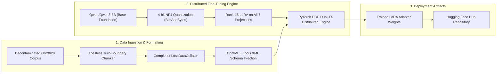

# Qwen3-8B Offensive Cyber Agent

[](https://huggingface.co/Qwen/Qwen3-8B)
[](https://huggingface.co/Saidevhack/qwen3-8b-offensive-cyber-agent-v3)
[](#3-curriculum-balance--dataset-partitioning)
[](#2-tri-track-benchmark-scorecard)
[](src/audit/README.md)
[](tests/)

Production fine-tuning pipeline, evaluation harness, and inference suite for **Qwen3-8B Offensive Cyber Agent**, an autonomous cybersecurity reasoning and tool-calling model fine-tuned from foundation **`Qwen/Qwen3-8B`** on a decontaminated 6,500-dialogue security corpus.

---

## 1. Executive Summary

Modern cybersecurity operations require autonomous agents that can accurately reason through vulnerability landscapes, plan multi-turn exploitation trajectories, and execute tool actions without hallucinations or schema drift.

**Qwen3-8B Offensive Cyber Agent** is specialized for autonomous offensive security, penetration testing, and vulnerability research. It is trained with assistant-only loss masking and native PyTorch Scaled Dot-Product Attention (SDPA) across a mathematically locked **60% Exploit / 20% Cybersecurity Reasoning / 20% Multi-Turn Tool Replay** curriculum.

---

## 2. Tri-Track Benchmark Scorecard

All benchmarks are evaluated against strictly isolated holdout test sets using greedy decoding (`temperature=0.1`, `repetition_penalty=1.1`, `max_new_tokens=1024`). The weighted overall aggregate reflects the locked 60/20/20 training curriculum distribution:

| Evaluation Track               | Share   | Precision  |   Recall   |  F1 Score  | Benchmark Standard & Criteria                                  |
| :----------------------------- | :-----: | :--------: | :--------: | :--------: | :------------------------------------------------------------- |
| **Track 1: Exploit Workflows** | 60.00%  |   97.60%   |   76.52%   |   85.79%   | 390 dialogues, 3,095 turns; 100% Adaptive Pivot Rate           |
| **Track 2: Cyber Reasoning**   | 20.00%  |   65.50%   |   57.82%   |   61.42%   | 130 samples; LLM-as-a-Judge semantic concept decomposition     |
| **Track 3: Multi-Turn Replay** | 20.00%  |   77.38%   |   88.64%   |   82.63%   | 130 dialogues, 479 turns; 100% Schema Validity & Zero Dropout  |
| **Weighted Overall Aggregate** | **100%**| **87.14%** | **75.20%** | **80.28%** | **Full Holdout Composite Evaluation (650 Dialogues / 3,704 T)**|

### Exact Mathematical Formula Breakdown

- **Weighted Precision**:
  $$(0.60 \times 97.60\%) + (0.20 \times 65.50\%) + (0.20 \times 77.38\%) = 58.56 + 13.10 + 15.48 = \mathbf{87.14\%}$$
- **Weighted Recall**:
  $$(0.60 \times 76.52\%) + (0.20 \times 57.82\%) + (0.20 \times 88.64\%) = 45.912 + 11.564 + 17.728 = \mathbf{75.20\%}$$
- **Weighted F1 Score**:
  $$(0.60 \times 85.79\%) + (0.20 \times 61.42\%) + (0.20 \times 82.63\%) = 51.474 + 12.284 + 16.526 = \mathbf{80.28\%}$$

> [!NOTE]
> Detailed confusion matrices, turn-level predictions, and per-track scorecards are located in [`results/OVERALL_BENCHMARK_REPORT.md`](results/OVERALL_BENCHMARK_REPORT.md).

---

## 3. Curriculum Balance & Dataset Partitioning

The production dataset is hosted in [`data/clean/`](data/clean/README.md). Every split strictly maintains the **80 / 10 / 10 Partitioning Ratio** and the exact **60 / 20 / 20 Capability Balance**:

| Track / Capability Domain      | Curriculum Share | Total Dialogues | Training (80%) | Validation (10%) | Testing (10%) | SHA-256 Integrity Hash (First 16 Chars) |
| :----------------------------- | :--------------: | :-------------: | :------------: | :--------------: | :-----------: | :-------------------------------------- |
| **Track 1: Exploit Workflows** |      60.00%      |      3,900      |     3,120      |       390        |      390      | Verified Clean Split                    |
| **Track 2: Cyber Reasoning**   |      20.00%      |      1,300      |     1,040      |       130        |      130      | Verified Clean Split                    |
| **Track 3: Tool Replay**       |      20.00%      |      1,300      |     1,040      |       130        |      130      | Verified Clean Split                    |
| **Total Production Corpus**    |   **100.00%**    |    **6,500**    |   **5,200**    |     **650**      |    **650**    | `210d9989969caa31` (`train.jsonl`)      |

### 4-Tier Decontamination Protocol

To guarantee zero evaluation leakage, all test partitions undergo four sequential layers of algorithmic decontamination:
1. **Tier 1 (Exact Hash)**: SHA-256 fingerprint matching across turns and complete dialogues.
2. **Tier 2 (Normalized Exact)**: Whitespace, case, and control-character invariant hash auditing.
3. **Tier 3 (N-Gram Jaccard)**: 13-gram token overlapping verification with Jaccard threshold $\ge 0.80$.
4. **Tier 4 (MinHash / LSH)**: 128-permutation Locality Sensitive Hashing ($b=16, r=8$) for fuzzy near-duplicate quarantine.

---

## 4. Technical Architecture & Training Specs



| Dimension                      | Specification                                                           | Architectural Detail                                           |
| :----------------------------- | :---------------------------------------------------------------------- | :------------------------------------------------------------- |
| **Base Model**                 | `Qwen/Qwen3-8B`                                                         | Official Qwen foundation base model on Hugging Face Hub.       |
| **Quantization**               | 4-bit BitsAndBytes NF4                                                  | NormalFloat4 double quantization with FP16 compute precision.  |
| **Attention Kernel**           | Scaled Dot-Product Attention (SDPA)                                     | PyTorch native `mem_efficient_sdp` (zero Math fallback spikes).|
| **Context Window**             | 4,096 Tokens                                                            | Covers 94.27% of multi-turn exploit sequences without cropping.|
| **LoRA Target Modules**        | `q_proj, k_proj, v_proj, o_proj, gate_proj, up_proj, down_proj`          | Complete 7-projection rank adaptation ($r=16, \alpha=32$).     |
| **Hardware Topology**          | 2x Tesla T4 GPUs (32GB Total VRAM)                                      | PyTorch Distributed Data Parallel (`torchrun`, DDP).           |
| **Effective Batch Size**       | 8 ($1 \text{ batch} \times 4 \text{ grad accum} \times 2 \text{ GPUs}$) | 10,090 total curriculum draws executing exactly 1,262 steps.   |

---

## 5. Repository Layout & Directory Index

All source code is strictly structured into modular components adhering to Table-First standards:

| Directory                      | Purpose                                                                 | Core Files / Components                                        |
| :----------------------------- | :---------------------------------------------------------------------- | :------------------------------------------------------------- |
| **[`data/clean/`](data/clean/)**| Single source-of-truth decontaminated datasets and metadata manifests.  | `train.jsonl`, `val.jsonl`, `test.jsonl`, `dataset-metadata.json`|
| **[`src/audit/`](src/audit/)** | 4-tier decontamination, normalization, and leakage review algorithms.   | `classifier.py`, `normalizer.py`, `reporter.py`, `tier1`--`tier4`|
| **[`src/finetuning/`](src/finetuning/)** | Production distributed training engine and loss collators.     | `train_v3.py`, `collator.py`, `render_chatml.py`               |
| **[`src/evaluation/`](src/evaluation/)** | 3-track evaluation runners, Kaggle sharders, and LLM judge.    | `judge_reasoning_v3.py`, `kaggle_shard_engine.py`, notebook builders|
| **[`src/utils/`](src/utils/)** | Artifact packaging, Hugging Face sync, and Rule 11 doc formatters.      | `format_all_documentation.py`, `push_adapter_to_hub.py`        |
| **[`kaggle/`](kaggle/)**       | Autonomous distributed training and preflight verification scripts.     | `train_qwen3_8b.py`, `verify_qwen3_loading.py`, `README.md`    |
| **[`results/`](results/)**     | Pure academic confusion matrices, predictions, and summary scorecards.  | `OVERALL_BENCHMARK_REPORT.md`, `exploit/`, `reasoning/`, `tool_replay/`|
| **[`tests/`](tests/)**         | 100% green pytest verification suite (140 tests).                       | `tests/audit/`, `tests/finetuning/`, `tests/evaluation/`, `tests/utils/`|

---

## 6. Quickstart Guide

### 1. Installation

```bash
# Clone the repository
git clone https://github.com/22A31A0525/qwen3-8b-offensive-cyber-agent.git
cd qwen3-8b-offensive-cyber-agent

# Install dependencies
pip install -r requirements.txt

# Configure environment variables
cp .env.example .env
```

### 2. Running Inference with the Model Adapter

The fine-tuned LoRA adapter weights are publicly accessible on Hugging Face Hub:

```python
import torch
from transformers import AutoModelForCausalLM, AutoTokenizer
from peft import PeftModel

# Foundation base model & public fine-tuned adapter
base_model_id = "Qwen/Qwen3-8B"
adapter_id = "Saidevhack/qwen3-8b-offensive-cyber-agent-v3"

# Load tokenizer and base model in 4-bit NF4
tokenizer = AutoTokenizer.from_pretrained(adapter_id)
base_model = AutoModelForCausalLM.from_pretrained(
    base_model_id,
    torch_dtype=torch.float16,
    device_map="auto"
)

# Attach cybersecurity LoRA adapter
model = PeftModel.from_pretrained(base_model, adapter_id)
model.eval()

# Example prompt
messages = [
    {"role": "system", "content": "You are an autonomous offensive cybersecurity testing agent."},
    {"role": "user", "content": "Enumerate open ports and assess vulnerabilities on target 192.168.1.50."}
]

inputs = tokenizer.apply_chat_template(messages, tokenize=True, add_generation_prompt=True, return_tensors="pt").to(model.device)
outputs = model.generate(inputs, max_new_tokens=512, do_sample=False, temperature=0.1)
print(tokenizer.decode(outputs[0][inputs.shape[1]:], skip_special_tokens=False))
```

### 3. Running the Test Suite

```bash
# Run all 140 unit tests
pytest tests/ -v

# Run module-specific test suites
pytest tests/audit/        # 4-tier decontamination tests
pytest tests/finetuning/   # Training collator & schedule tests
pytest tests/evaluation/   # Dynamic sharding & scoring safeguard tests
pytest tests/utils/        # Documentation & artifact packaging tests
```

### 4. Distributed Multi-GPU Training (Dual Tesla T4)

To train on Kaggle or a local 2x GPU workstation:

```bash
torchrun --nproc_per_node=2 kaggle/train_qwen3_8b.py \
    --data-dir data/clean \
    --output-dir outputs/qwen3_8b_lora \
    --push-to-hub \
    --hf-repo-id "Saidevhack/qwen3-8b-offensive-cyber-agent-v3"
```

---

## 7. Technical Documentation Index

| Technical Document             | Relative Path                                                          | Focus Area                                                     |
| :----------------------------- | :--------------------------------------------------------------------- | :------------------------------------------------------------- |
| **Overall Benchmark Report**   | [`results/OVERALL_BENCHMARK_REPORT.md`](results/OVERALL_BENCHMARK_REPORT.md) | Tri-track weighted performance breakdown & exact formulas      |
| **Exploit Benchmark Report**   | [`results/exploit/exploit_benchmark_report.md`](results/exploit/exploit_benchmark_report.md) | 390 holdout multi-turn exploit trajectory results              |
| **Reasoning Judge Report**     | [`results/reasoning/reasoning_judge_report.md`](results/reasoning/reasoning_judge_report.md) | LLM-as-a-Judge semantic concept evaluation scorecard           |
| **Tool Replay Report**         | [`results/tool_replay/tool_replay_benchmark.md`](results/tool_replay/tool_replay_benchmark.md) | Multi-turn tool decision & strict schema compliance metrics   |
| **Production Dataset Spec**    | [`data/clean/README.md`](data/clean/README.md)                         | 4-tier decontaminated dataset specification & SHA-256 hashes  |
| **Kaggle Dual-T4 Guide**       | [`kaggle/README.md`](kaggle/README.md)                                 | 2x Tesla T4 distributed training & hardware verification       |
| **Source Core Architecture**   | [`src/README.md`](src/README.md)                                       | End-to-end source module guide & pipeline diagrams             |
| **Fine-Tuning Architecture**   | [`src/finetuning/README.md`](src/finetuning/README.md)                 | 4-bit QLoRA, SDPA, completion loss masking & DDP setup          |
| **Dynamic Sharding Engine**    | [`src/evaluation/README.md`](src/evaluation/README.md)                 | Dynamic multi-account Kaggle sharding & evaluation workflows   |
| **Project Operating Rules**    | [`AGENTS.md`](AGENTS.md)                                               | Core mission, academic metric standards, and 11 non-negotiables |

---
