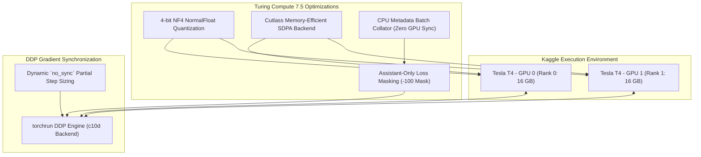

# Kaggle Dual-T4 Distributed Execution (`kaggle/`)

[-orange.svg)](#2-hardware-architecture--sdpa-optimizations)
[-blue.svg)](#2-hardware-architecture--sdpa-optimizations)
[-purple.svg)](#3-distributed-training-pipeline)
[](#1-file-manifest--component-inventory)

This directory contains the production-grade, self-contained scripts and kernel manifests engineered specifically to execute the **Qwen3-8B Latest Version (v3)** training and verification pipelines on **Kaggle Dual Tesla T4 GPUs** (Compute 7.5 Turing architecture).

---

## 1. File Manifest & Component Inventory

| File / Component          | Category              | Primary Purpose                                                          | Execution Target                       |
| :------------------------ | :-------------------- | :----------------------------------------------------------------------- | :------------------------------------- |
| `train_qwen3_8b.py`       | Distributed Trainer   | 1-epoch distributed DDP training with resumable checkpoints and HF sync. | Dual Tesla T4 GPUs (`torchrun`, DDP)   |
| `verify_qwen3_loading.py` | Hardware Verification | Verifies 4-bit NF4 loading, SDPA attention, and VRAM memory footprint.   | Dual Tesla T4 GPUs (Single Subprocess) |
| `kernel-metadata.json`    | Kaggle Manifest       | Configuration metadata for Kaggle API kernel deployment and runtime.     | Kaggle Script Kernel Environment       |
| `t4_bounded_attention.py` | Hardware Optimization | Turing SDPA attention bounded patching preventing Math backend spikes.   | PyTorch Attention Backend              |
| `probe_t4_sdpa.py`        | Hardware Diagnostic   | Probes SDPA kernel selection (FlashAttention vs Efficient vs Math).      | PyTorch SDPA Runtime Engine            |

---

## 2. Hardware Architecture & SDPA Optimizations

Training an 8-billion parameter model on dual 16GB Tesla T4 GPUs presents severe memory and compute constraints. The scripts in this directory implement specialized architectural guarantees:



### Key Technical Specifications

| Parameter                | Production Specification                                                  | Technical Rationale                                              |
| :----------------------- | :------------------------------------------------------------------------ | :--------------------------------------------------------------- |
| **Quantization**         | BitsAndBytes 4-bit NF4 (`load_in_4bit=True`, `bnb_4bit_quant_type="nf4"`) | Compresses base model footprint to ~5.5 GB VRAM per GPU.         |
| **Compute Precision**    | FP16 (`torch.float16`)                                                    | Native compute format for Turing architecture Tensor Cores.      |
| **Attention Kernel**     | Scaled Dot-Product Attention (SDPA, `mem_efficient_sdp`)                  | Replaces uncompiled Math fallback; prevents 500 MiB VRAM spikes. |
| **Sequence Length**      | 4,096 Tokens                                                              | Accommodates 94.27% of multi-turn exploit trajectories intact.   |
| **LoRA Target Modules**  | `q_proj, k_proj, v_proj, o_proj, gate_proj, up_proj, down_proj`           | Complete 7-projection rank adaptation ($r=16, \alpha=32$).       |
| **Effective Batch Size** | 8 ($1 \text{ batch} \times 4 \text{ grad accum} \times 2 \text{ GPUs}$)   | Maximizes gradient stability while operating within 16GB VRAM.   |

---

## 3. Distributed Training Pipeline (`train_qwen3_8b.py`)

`train_qwen3_8b.py` is an autonomous, self-healing trainer executing a full 1-epoch curriculum on Kaggle.

### Core Execution Guarantees

1. **Lossless Turn-Boundary Chunking**:
   Dialogues exceeding 4,096 tokens are partitioned at turn boundaries so that no assistant target is truncated or split across chunks.
2. **Deterministic Stratified Curriculum**:
   Draws exactly 10,090 samples across the fixed 60% Exploit / 20% Reasoning / 20% Tool Replay distribution, completing in strictly 1,262 optimizer steps.
3. **Resumable State Checkpointing**:
   Saves full model adapter weights, AdamW optimizer states, cosine learning rate scheduler states, PyTorch RNG states, and curriculum sampler progress at designated intervals.
4. **Fail-Closed Dataset Integrity**:
   Calculates and asserts the SHA-256 checksums of `train.jsonl` and `val.jsonl` prior to initializing any model weights:
   - **`train.jsonl`**: `210d9989969caa3102a1ee3c61e279b5837b4e2c807fdc73a54bc334e96ad465`
   - **`val.jsonl`**: `95e7def8fc6b03362d4fdff507c781ff7613ab0dbf03b20ed257974e7d41bdfd`

---

## 4. Verification Suite (`verify_qwen3_loading.py`)

Before initiating intensive 1-epoch training runs, `verify_qwen3_loading.py` executes an isolated pre-flight sanity pass:

| Verification Phase              | Checks Performed                                                                            | Pass Criteria                                                       |
| :------------------------------ | :------------------------------------------------------------------------------------------ | :------------------------------------------------------------------ |
| **1. Dependency Check**         | Verifies `peft`, `bitsandbytes`, `accelerate`, and `transformers`.                          | All modules import cleanly; auto-installs if absent.                |
| **2. Hardware Topology**        | Detects GPU count, CUDA compute capability, and device names.                               | Strictly 2x Tesla T4 GPUs with $\ge$ 14.5 GB available VRAM.        |
| **3. Quantization Load**        | Loads `Qwen/Qwen3-8B` using 4-bit BitsAndBytes NF4 double quantization.                     | Successful parameter allocation without OOM errors.                 |
| **4. SDPA Attention Audit**     | Validates PyTorch SDPA implementation (`torch.nn.functional.scaled_dot_product_attention`). | Fused/Cutlass kernel selected; Math fallback rejected.              |
| **5. VRAM Footprint Profiling** | Measures peak memory consumption post-model-allocation.                                     | Allocated memory strictly $< 7.5 \text{ GB}$ per device.            |
| **6. Inference Sanity Pass**    | Generates tokens for a dummy prompt using ChatML role markers.                              | Generates coherent text with correct `<&#124;im_end&#124;>` tokens. |

---

## 5. Kaggle Deployment & Execution Workflow

### A. Environment Configuration & Secrets

Set the following credentials via **Kaggle Add-ons -> Secrets** or shell environment variables:

| Secret Name       | Purpose                                                             | Required For                            |
| :---------------- | :------------------------------------------------------------------ | :-------------------------------------- |
| `HF_TOKEN`        | Hugging Face API token with write permissions for automated upload. | Hub model publication & checkpoint sync |
| `KAGGLE_USERNAME` | Kaggle user handle for dataset and kernel referencing (optional).   | Automated Kaggle CLI execution          |
| `KAGGLE_KEY`      | Kaggle API token for kernel pushing and log pulling (optional).     | Automated Kaggle CLI execution          |

### B. Running Verification via CLI

```bash
python kaggle/verify_qwen3_loading.py
```

To perform a fast dry-run without downloading model weights:
```bash
python kaggle/verify_qwen3_loading.py --dry-run
```

### C. Launching Distributed Training

To launch dual-GPU training on a local multi-GPU rig or Kaggle terminal:

```bash
torchrun --nproc_per_node=2 kaggle/train_qwen3_8b.py \
    --data-dir data/clean \
    --output-dir outputs/qwen3_8b_retrained \
    --push-to-hub \
    --hf-repo-id "<your-hf-org>/qwen3-8b-offensive-cyber-agent"
```

### D. Pushing Kernel to Kaggle via API

Ensure `kaggle/kernel-metadata.json` has your Kaggle username configured, then execute:

```bash
kaggle kernels push -p kaggle/
```

To monitor execution logs:

```bash
kaggle kernels status <kaggle-username>/qwen3-8b-v3-retraining-full-epoch
kaggle kernels output <kaggle-username>/qwen3-8b-v3-retraining-full-epoch
```

---

## 6. CLI Command-Line Reference (`train_qwen3_8b.py`)

| Flag                       | Type   | Default Value                                  | Description                                                   |
| :------------------------- | :----- | :--------------------------------------------- | :------------------------------------------------------------ |
| `--data-dir`               | String | Auto-detected (`data/clean` or Kaggle input)   | Directory containing `train.jsonl` and `val.jsonl`.           |
| `--output-dir`             | String | `./qwen3_8b_lora_output`                       | Directory to save checkpoint artifacts and final adapter.     |
| `--base-model-id`          | String | `Qwen/Qwen3-8B`                                | Hugging Face repository ID of the base foundation model.      |
| `--resume-from-checkpoint` | String | `None`                                         | Path or Hugging Face Hub ID of intermediate step checkpoint.  |
| `--hf-repo-id`             | String | `Saidevhack/qwen3-8b-offensive-cyber-agent-v3` | Target Hugging Face Hub repository for final adapter weights. |
| `--hf-checkpoint-repo-id`  | String | `...-checkpoints`                              | Target Hugging Face Hub repository for resumable checkpoints. |
| `--push-to-hub`            | Flag   | `False`                                        | Automatically sync checkpoints and final weights to Hub.      |
| `--hf-public`              | Flag   | `False`                                        | Sets Hugging Face repository visibility to public on upload.  |
| `--smoke-segment`          | Flag   | `False`                                        | Runs a short smoke test segment (2-4 steps) for verification. |
