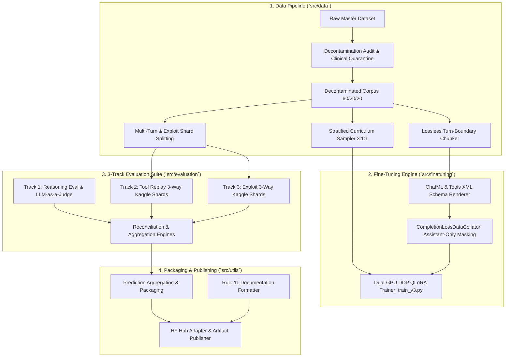

# Source Code Architecture (`src/`)

Welcome to the core source module tree for **Qwen3-8B Latest Version (v3)**. This directory contains production-grade, modular Python implementations supporting dataset preparation, distributed LoRA fine-tuning, 3-track evaluation orchestration, and model/artifact packaging.

---

## 1. High-Level Architectural Overview

The pipeline operates across four decoupled submodules:

---

## 2. Directory Layout & Module Index

| Directory                                     | Purpose                                                                          | Core Files                                                                                                                                      | Key Technologies                                                               |
| :-------------------------------------------- | :------------------------------------------------------------------------------- | :---------------------------------------------------------------------------------------------------------------------------------------------- | :----------------------------------------------------------------------------- |
| **[`src/data/`](data/README.md)**             | Data preparation, lossless chunking, decontamination, and stratified sampling.   | `improved_chunker.py`, `sampler.py`, `run_decontamination_audit.py`, `create_derived_decontaminated_dataset.py`, `split_multiturn_shards_v3.py` | PyTorch `Sampler`, SHA-256 verification, AST parsing, Multiprocessing          |
| **[`src/finetuning/`](finetuning/README.md)** | Production multi-GPU LoRA training and completion loss masking.                  | `train_v3.py`, `collator.py`, `render_chatml.py`                                                                                                | PyTorch DDP, BitsAndBytes 4-bit NF4, PEFT LoRA, HuggingFace Transformers, SDPA |
| **[`src/evaluation/`](evaluation/README.md)** | 3-track benchmark runners, Kaggle dual-GPU notebook generators, and reconcilers. | `judge_reasoning_v3.py`, `build_3way_exploit_notebooks.py`, `build_3way_tool_replay_notebooks.py`, `reconcile_and_push_*.py`                    | G-Eval, Groq API (Qwen3.8-27B), Kaggle API, Multi-threading                    |
| **[`src/utils/`](utils/README.md)**           | Prediction packaging, documentation linting, and Hugging Face Hub publication.   | `package_predictions_clean.py`, `package_final_dataset_results.py`, `push_adapter_to_hub.py`, `format_all_documentation.py`                     | Hugging Face Hub API, JSONL serialization, GFM table alignment                 |

---

## 3. End-to-End Execution Flow

1. **Dataset Decontamination & Audit**:
   - Audit raw source data for benchmark contamination (`run_decontamination_audit.py`).
   - Quarantine leaked dialogue IDs and inject pristine hermes replacements (`create_derived_decontaminated_dataset.py`).
   - Validate context length boundaries and assistant target coverage (`run_dataset_lossless_audit.py`).

2. **Curriculum Fine-Tuning**:
   - Construct training batches enforcing the exact 3:1:1 curriculum ratio (60% Exploit, 20% Reasoning, 20% Tool Replay) via `StratifiedCurriculumSampler`.
   - Render conversations into ChatML with `<tools>` XML schema injection (`render_chatml.py`).
   - Compute loss exclusively on assistant response tokens using `CompletionLossDataCollator` (`collator.py`).
   - Execute distributed multi-GPU training with PyTorch Scaled Dot-Product Attention (SDPA) (`train_v3.py`).

3. **Multi-Track Evaluation & Sharding**:
   - Partition 390 exploit dialogues and 130 tool replay dialogues across 3 Kaggle auxiliary accounts (`build_3way_exploit_notebooks.py`, `build_3way_tool_replay_notebooks.py`).
   - Execute pure reasoning benchmark on dedicated GPU runner and grade responses with Groq LLM-as-a-Judge (`judge_reasoning_v3.py`).
   - Reconcile distributed shards, check for ID completeness, and calculate global metrics (`reconcile_and_push_*.py`).

4. **Artifact Compilation & Hub Deployment**:
   - Package turn-level and dialogue-level predictions with metadata (`package_predictions_clean.py`).
   - Export dataset manifests and SHA-256 integrity checksums (`package_final_dataset_results.py`).
   - Upload trained LoRA adapter weights, evaluations, and model cards to Hugging Face Hub (`push_adapter_to_hub.py`).

---

## 4. Development & Verification Directives

- **Clean Imports**: All internal source references use absolute imports relative to project root (`src.finetuning`, `src.data`, `src.evaluation`, `src.utils`).
- **Fail-Closed Distributed Execution**: Scripts verify DDP rank environments and abort cleanly if requirements are not met.
- **Zero Truncation of Targets**: Every turn-boundary chunker and data collator strictly preserves assistant tokens.
