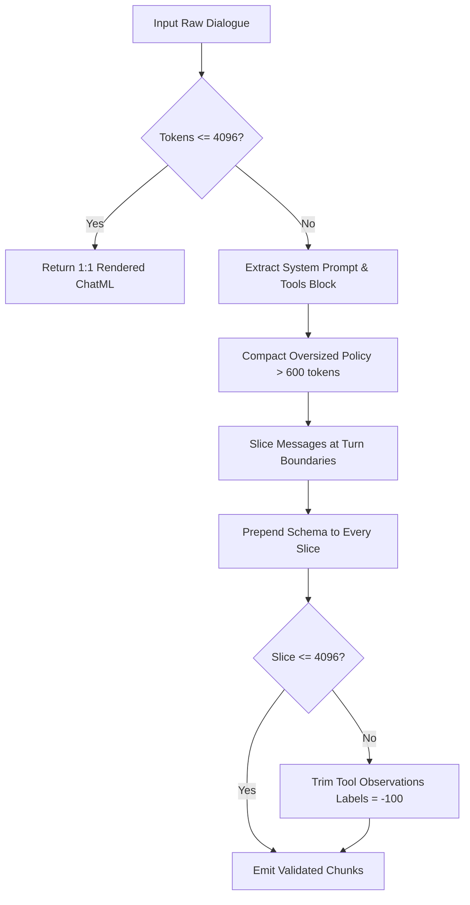

# Data Processing & Curriculum Pipeline (`src/data`)

This directory houses the data preparation, audit, chunking, stratified sampling, and evaluation sharding routines for **Qwen3-8B Latest Version (v3)**.

---

## 1. Module Overview & Responsibilities

| Script / Module                                                                            | Purpose                                                  | Key Classes & Functions                                            | Key Guarantees                                                                   |
| :----------------------------------------------------------------------------------------- | :------------------------------------------------------- | :----------------------------------------------------------------- | :------------------------------------------------------------------------------- |
| **[`improved_chunker.py`](improved_chunker.py)**                                           | Lossless turn-boundary chunking with schema preservation | `chunk_dialogue_lossless()`, `compact_oversized_policy()`          | 100% assistant target retention, $\le 4,096$ tokens, `<tools>` XML in all chunks |
| **[`sampler.py`](sampler.py)**                                                             | Distributed 3:1:1 curriculum batch sampler               | `StratifiedCurriculumSampler`, `StratifiedDistributedBatchSampler` | Strict 60/20/20 domain balance, deterministic DDP sharding, resumable offsets    |
| **[`create_derived_decontaminated_dataset.py`](create_derived_decontaminated_dataset.py)** | Generates versioned clean dataset in `data/clean/`       | `main()`, `compute_sha256()`                                       | Quarantines 3 leaked records, injects clean Hermes dialogues, locks SHA-256      |
| **[`run_decontamination_audit.py`](run_decontamination_audit.py)**                         | Cross-split contamination & leak scanner                 | `scan_dataset()`, `classify_leakage()`                             | N-gram, prompt hash, and tool call overlap detection                             |
| **[`run_dataset_lossless_audit.py`](run_dataset_lossless_audit.py)**                       | Comprehensive token & target audit report generator      | `audit_single_dialogue()`, `init_worker()`                         | Multiprocess validation of token lengths, boundary cuts, and schema persistence  |
| **[`split_multiturn_shards_v3.py`](split_multiturn_shards_v3.py)**                         | Conversation-wise evaluation test sharder                | `partition_records()`, `audit_shards()`                            | 3-way disjoint Kaggle partition, 100% turn boundary preservation                 |

---

## 2. Lossless Turn-Boundary Chunking (`improved_chunker.py`)

Multi-turn offensive cyber dialogues often exceed standard context limits ($> 4,096$ tokens) due to expansive tool outputs (e.g., nmap scans, disassembly dumps, exploit payloads). Naive character or token slicing drops system prompts or truncates assistant turns mid-generation.

`chunk_dialogue_lossless` solves this through five structural constraints:

1. **Assistant Target Invariance**: Every assistant target token across all turns in the dialogue is retained and supervised across the chunk set:
   $$\sum_{c_i \in \mathcal{C}} N_{\text{asst}}(c_i) \ge N_{\text{asst}}(\mathcal{D})$$
2. **Mandatory Schema Injection**: The system prompt containing canonical `<tools>` XML schema definitions is prepended to **100%** of generated chunks.
3. **Hard Context Budget**: Each chunk strictly satisfies $\text{len}(\text{tokens}) \le 4,096$.
4. **Turn-Boundary Slicing**: Slicing occurs strictly at turn delimiters (`<|im_start|>` and `<|im_end|>`).
5. **Observation Pruning Only**: If a single turn is larger than the budget, only tool execution returns (`role: tool`, where loss label is `-100`) are truncated or compressed. Assistant predictions are never truncated.

---

## 3. Stratified Curriculum Sampler (`sampler.py`)

The retraining curriculum enforces an exact **3:1:1 domain distribution**:
- **3 Parts Exploit (60%)**: Binary exploitation, vulnerability research, red teaming, exploit development.
- **1 Part Reasoning (20%)**: Pure conceptual cybersecurity reasoning without tools.
- **1 Part Tool Replay (20%)**: Multi-turn tool execution trajectories and structured API calling.

### Sampler Mechanics:
- **Global Deterministic Cycle**: For every 5 indices drawn globally:
  $$\text{Cycle} = [E_1, E_2, E_3, R_1, T_1]$$
- **Rank Interleaving**: In multi-GPU Distributed Data Parallel (DDP), the global schedule is partitioned disjointly:
  $$\text{Schedule}_{\text{rank}} = \text{GlobalSchedule}[\text{rank} :: \text{world\_size}]$$
  This guarantees zero sample duplication across GPUs while maintaining identical curriculum ratios on every GPU.
- **Resumable Offset**: `sampler.set_resume_step(step)` advances the internal iterator cleanly, enabling training to resume from an exact checkpoint without re-ingesting already seen records.
- **Dynamic Step Computation**:
  $$\text{Optimizer Steps} = \left\lfloor \frac{\text{Total Curriculum Draws}}{\text{World Size} \times \text{Batch Size} \times \text{Grad Accum Steps}} \right\rfloor$$

---

## 4. Decontamination Routines & Derived Dataset

### Audit Methodology (`run_decontamination_audit.py`)
The decontamination audit prevents benchmark contamination across all 6,500 dialogues by verifying:
- **Exact ID & Content Hash Match**: Dialogue IDs, message contents, and tool signatures.
- **13-Gram Overlap**: Sliding window scan against test benchmark holdouts.
- **High-Risk Indicator Match**: Target flag signatures and leaked challenge keys.

### Clinical Quarantine & Replacement (`create_derived_decontaminated_dataset.py`)
Three records were identified with potential benchmark leakage and quarantined:
- Training: `hermes_7e118bec-7d0b-462a-950e-a652743bf76e`
- Training: `hermes_3e2bdf27-eb65-4f7f-856b-a25e1bb69a8e`
- Validation: `hermes_bfc12eb2-fea8-4c51-b695-33c16030d4c9`

These records were replaced with pristine dialogues from `data/deduplicated/hermes.jsonl`, generating the immutable derived directory `data/clean/`:
- `data/clean/train.jsonl` (5,200 records: 3,120 Exploit, 1,040 Reasoning, 1,040 Replay)
- `data/clean/val.jsonl` (650 records: 390 Exploit, 130 Reasoning, 130 Replay)
- `data/clean/test.jsonl` (650 records: 390 Exploit, 130 Reasoning, 130 Replay)

---

## 5. Evaluation Shard Splitting (`split_multiturn_shards_v3.py`)

To evaluate the 130 holdout multi-turn tool replay dialogues and 390 holdout exploit dialogues across Kaggle's dual-GPU quotas, `split_multiturn_shards_v3.py` partitions holdout datasets into 3 disjoint shards:

| Shard Index | Target Shard Account  | Exploit Test Count |  Tool Replay Test Count  | Integrity Assurance          |
| :---------: | :-------------------- | :----------------: | :----------------------: | :--------------------------- |
| **Shard 1** | `Account 1 / Shard 1` |   130 dialogues    | 44 dialogues (148 turns) | Disjoint ID set, 0 turn cuts |
| **Shard 2** | `Account 2 / Shard 2` |   130 dialogues    | 43 dialogues (172 turns) | Disjoint ID set, 0 turn cuts |
| **Shard 3** | `Account 3 / Shard 3` |   130 dialogues    | 43 dialogues (159 turns) | Disjoint ID set, 0 turn cuts |

Each split is validated with strict assertion checks:
- Set intersection of dialogue IDs across shards is empty: $\mathcal{S}_1 \cap \mathcal{S}_2 \cap \mathcal{S}_3 = \emptyset$.
- Sum of assistant turns across shards exactly equals the unpartitioned holdout set.
